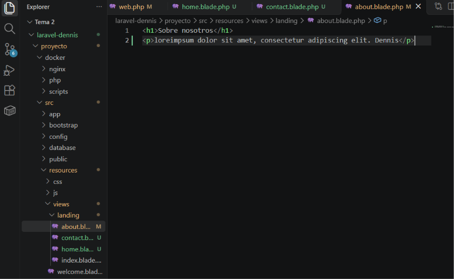
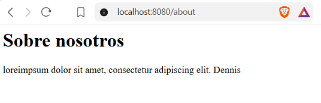
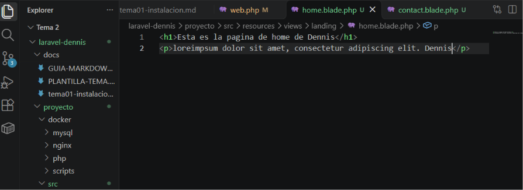
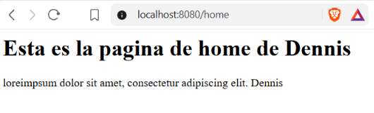
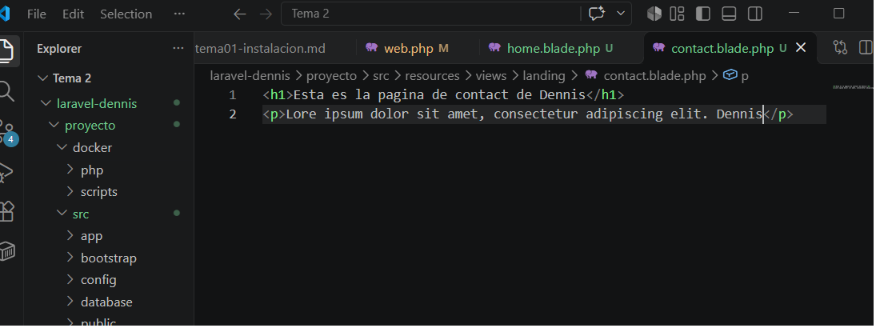

# Tema 01: Instalación con Docker

| | |
|---|---|
| **Fecha de inicio** | 09/11/2026 |
| **Fecha de fin** | 16/11/2026 |
| **Tiempo dedicado** | 4 horas |
| **Rama de Git** | `tema01` |

---

## 1. 🎯 Objetivo del tema

Instalación del proyecto con Docker y creación del proyecto Laravel.

---

## 2. 🛠️ Desarrollo paso a paso

<!-- Un apartado por cada paso importante. Para cada uno:
     - Qué haces y POR QUÉ.
     - El comando o el código, en un bloque de código (nunca como captura).
     - Una captura solo si aporta algo visual (navegador, resultado, estructura...). -->

### 2.1 Creacion de vistas

Se van a crear 3 vistas creadas home, about y contact.


### 2.2 Difinición de rutas

Se modficica el fochero *route/web.php* de la siguiente forma:
```php
Route::view('/', 'landing.home')-> name('home');
Route::view('/about', 'landing.about')-> name('about');
Route::view('/contact', 'landing.contact')-> name('contact');
```

---

## 3. 📋 Resumen de comandos utilizados

## Docker Compose

| Comando | Para qué sirve |
|---------|----------------|
| `docker compose up --build` | Construir imágenes y levantar contenedores (primera vez o tras cambiar `Dockerfile`/`docker-compose.yml`) |
| `docker compose up --build -d` | Lo mismo, en segundo plano |
| `docker compose up` | Levantar contenedores sin reconstruir |
| `docker compose up -d` | Levantar contenedores en segundo plano |
| `docker compose down` | Parar y eliminar los contenedores |
| `docker compose exec php bash` | Entrar en una consola dentro del contenedor PHP |
| `docker-compose down` | Versión antigua de `docker compose down` (la usa la 2.4) |
| `docker-compose up -d` | Versión antigua de `docker compose up -d` (la usa la 2.4) |

## Docker

| Comando | Para qué sirve |
|---------|----------------|
| `docker ps` | Listar contenedores en ejecución y ver su nombre real |
| `docker exec -it nombre_del_contenedor mysql -uroot -p` | Abrir el cliente MySQL en un contenedor concreto |
| `docker exec -it laravel_app_php_1 bash` | Entrar en el contenedor PHP indicando su nombre |

## Composer

| Comando | Para qué sirve |
|---------|----------------|
| `composer --version` | Comprobar que Composer está instalado en el contenedor |
| `composer create-project laravel/laravel:^12.0 .` | Crear el proyecto Laravel 12 en la carpeta actual |

## Laravel (instalador)

| Comando | Para qué sirve |
|---------|----------------|
| `laravel --version` | Comprobar la versión del instalador |
| `laravel new nombre-del-proyecto` | Crear un nuevo proyecto Laravel |


## Terminal (Linux / shell)

| Comando | Para qué sirve |
|---------|----------------|
| `cd src` | Entrar en la carpeta de trabajo del proyecto |
| `rm index.php` | Borrar el `index.php` de prueba antes de instalar Laravel |
| `pwd` | Ver en qué carpeta estás |
| `cd /var/www/html` | Ir a la carpeta donde está montado `src/` dentro del contenedor |


---

## 4. 🐞 Problemas encontrados y soluciones

<!-- Documenta TODOS los problemas, aunque te parezcan tontos.
     Copia el error como texto, no como captura.
     Si no has tenido ningún problema, documenta al menos algo que hayas tenido que investigar. -->

### Problema 1: Comprobación del funcionamiento de Laravel despues de su instalación

**Qué estaba haciendo:** Comprobar el correcto funcionamiento de Laravel una vez creado el proyecto basico.

**Error:**

```
Acceso Denegado
```

**Causa:** Posible problema de permisos

**Solución:**

Ejecutamos en una terminal los siguientes comandos.
```bash
docker exec -it proyecto-php-1 bash
php artisan key:generate
chmod -R 775 storage bootstrap/cache
chown -R www-data:www-data storage bootstrap/cache
```

Posteriormente será necesario añadir en un fichero .env la siguiente configuración.

```bash
DB_HOST=mysql
DB_PORT=3306
DB_DATABASE=test
DB_USERNAME=alumno
DB_PASSWORD=alumno
SESSION_DRIVER=file
```

**Fuente:** ChatGPT.

---

## 5. ✅ Resultado final

<!-- Captura(s) de la aplicación funcionando al terminar el tema. -->

Vista *about.blade.php*




Vista *home.blade.php*



Vista *contact.blade.php*



---

## 6. 💭 Conclusiones

- **Qué he aprendido:** He aprendido lo que son los Frameworks, a configurar un docker y a instalar y configurar Laravel.
- **Qué me ha costado más:** Cuando se dio el problema de acceso
- **Qué haría diferente / dudas pendientes:** Nada, quizás tenga algunos problemas a futuro si tengo que volver a instalar y configurarlo todo pero bajo los apuntes y algunas anotaciones dudo tener muchos problemas.
